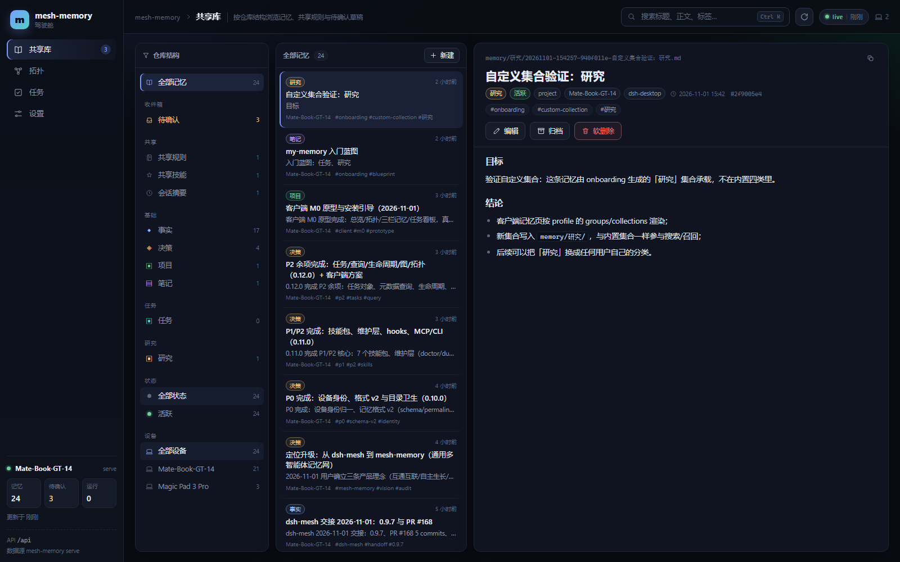
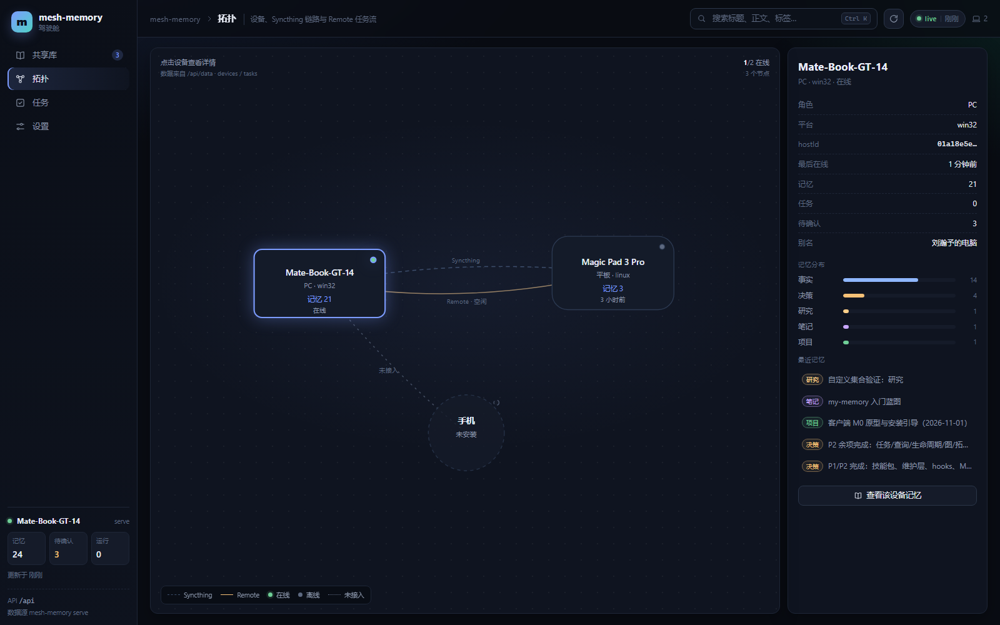

# mesh-memory

> 给 AI 智能体的**共享记忆网**：一份 Markdown，多台设备、多个智能体共用；自主生长，但每一步可审阅。


**真源永远是你能打开、能 diff 的纯文本。** 没有向量库黑盒，没有云端账号，记忆和行动都不出你的设备（除非你显式用远程中继）。



---

## 三条理念

| 理念 | 含义 |
|---|---|
| **互通互联** | 一台设备上的智能体写下的记忆，另一台的智能体立刻能读到；任务也能跨设备派发与回收 |
| **自主生长** | 会话自动沉淀进收件箱，定期反思/体检/去重；人只做审阅，不做搬运 |
| **直观便捷** | 一个 Web 界面覆盖日常；召回过程看得见；手机上也能用 |

## 它解决什么问题

主流 AI 工具的"记忆"是：存在厂商服务器上、不能导出、看不见它记住了什么、换一个工具就重来一遍。

mesh-memory 把记忆写成一张张 Markdown 卡片，放在你自己的目录里：

- **谁来读都行**：DSH 插件、MCP、CLI、HTTP 四种入口读同一份文件；
- **谁来写都行**：人和智能体改的是同一批 `.md`，靠 frontmatter 的 `checksum` 做乐观锁，冲突显式报 409 而不是静默覆盖；
- **怎么同步**：Syncthing 只搬字节，冲突副本留给上层裁决；
- **怎么生长**：会话结束自动进收件箱，`mesh-*` 技能负责反思、去重、体检、整理。

**不是**：不是向量库、不做云服务、不同步原始会话日志（单写者会冲突）、不替上游做账号与中继。

## 核心能力

| 能力 | 说明 |
|---|---|
| 记忆 CRUD | 新建 / 编辑 / 归档 / 软删除（`.trash/`）/ 恢复，全部带 checksum 乐观锁 |
| 记忆格式 v2 | `permalink`、`checksum`、`source`、`agent`、`status`、`validAt` / `invalidAt` / `supersededBy` |
| 自动召回 | 每轮 BM25 + baseline + wikilink 1 跳，注入 `<mesh-memory>` 上下文，带预算与去重 |
| 无感记录 | 会话结束或空闲 5 分钟自动生成摘要草稿，进本机收件箱，**不参与召回**直到你接受 |
| 生命周期 | `active` / `archived` / `superseded` / `draft`；归档与过期都保留原文，可回溯 |
| 维护技能 | `mesh-capture` `mesh-reflect` `mesh-curate` `mesh-defrag` `mesh-doctor` `mesh-onboard` `mesh-continue` |
| 跨设备委托 | `mesh_run` / `mesh_read` / `mesh_interrupt` / 文件传输，走 DSH Remote |
| 任务对象 | 任务有 id / 状态 / 结果 / 取消，随共享目录同步 |
| 多入口 | DSH 插件、MCP server、CLI（`mm`）、HTTP REST + SSE |

## 界面

一个 Web 客户端，多个宿主，同一份构建。**目标形态：入口全部在应用里，用户不需要浏览器地址栏。**

| 入口 | 形态 | 状态 |
|---|---|---|
| DSH 桌面端「记忆」 | 应用内嵌 | 🚧 当前是旧简化面板，S4 换成完整客户端 |
| 独立桌面应用 | Tauri 2 托盘 | ⏳ S4 |
| 安卓 DSH Go | 应用内嵌 | 🚧 只读页，S4 接动作通道 |
| 开发 / 排障 | `127.0.0.1:8767/` | ✅ 仅开发用，**不是产品入口** |

六个视图：**共享库**（树 + 搜索 + 详情 + 编辑 + 待确认）、**召回**（分数 / 预算 / 注入预览 / 未达门槛）、**活动**（实时写入 + 最近变更）、**拓扑**（设备 / Syncthing / Remote 任务）、**任务**（看板）、**设置**。

> 召回测试台支持深链：`#/recall?q=你的问题`，把"这次召回"原样发给别人复现。
> 详情页可以看单条记忆的 **git 历史与 diff**，以及它**被召回过几次**。



## 架构

```
入口   DSH 插件 │ MCP server │ CLI(mm) │ HTTP(REST+SSE, 8767)
         └──────────────┬──────────────┘
核心   store(frontmatter/原子写) · recall · query · links · tasks · maintenance · capture
真源   memory/<collection>/*.md · sessions/ · tasks/ · AGENTS.shared.md · skills/
投影   index/profile.json · devices/*.json · manifest · 客户端缓存（可随时删）
同步   Syncthing（字节） · DSH Remote（行动） · 本机 git 快照（可回溯）
```

设计约束：**核心不含 UI，UI 不碰文件**；索引可丢弃，Markdown 可重建。

## 快速开始

```powershell
# 1) 装到 DSH profile（先备份，可 -Rollback）
pwsh -NoProfile -ExecutionPolicy Bypass -File .\install.ps1 -Profiles desktop

# 2) 起 Web 客户端（可选；插件内也已经托管一份）
npm run serve          # http://127.0.0.1:8767/

# 3) 跑测试
npm test
```

客户端源码在仓库外的 `client/`（Vite + React），构建产物输出到 `plugin/public`，随 `install.ps1` 一起装。

## 记忆格式

```markdown
---
title: 家里网络是 iKuai，网关 192.168.9.1
description: 一句话说清结论（检索主要靠这行）
kind: facts
memoryType: reference
tags: [network, home]
device: mate-book-gt-14
agent: dsh-desktop
permalink: 家里网络是-ikuai-网关-192-168-9-1
checksum: 3d1f8c2a
status: active
createdAt: 2026-11-01T10:00:00+08:00
updatedAt: 2026-11-01T10:00:00+08:00
---

正文……
```

`[[wikilink]]` 会自动进图；`supersededBy` / `invalidAt` 用来表达"过时但不删"。

## 接口

| 形态 | 位置 | 用途 |
|---|---|---|
| DSH 工具 | `mesh_status` / `mesh_memory_*` / `mesh_run` … | 在 DSH 会话里直接用 |
| MCP | `adapters/mcp-server.mjs` | 任意 MCP 客户端（Claude Desktop / Cursor…） |
| CLI | `bin/mm.mjs`（`npm run mm -- search …`） | 脚本与运维 |
| HTTP | `bin/mm-serve.mjs` | Web 客户端与外部集成 |

写操作统一要求 `x-mesh-action: 1` 且同源；只绑回环。

## 跨设备

- **记忆**：Syncthing 同步目录；冲突文件（`.sync-conflict-*`）不静默合并，由界面裁决。
- **行动**：DSH Remote 委托另一台设备建会话、执行、读结果；任务状态随共享目录回传。
- **备份**：本机 git 快照（`$DSH_HOME/dsh-mesh-backups.git`，名字待迁移），不进同步目录。

## 安全与边界

- 只监听回环；写操作要求自定义头 + 同源校验。
- 文件传输限定在配置根目录内，拒绝密钥/凭据类文件。
- 远程内容（会话、网页、文件名）一律当不可信数据处理，不自动执行。
- 记忆不出本机/局域网；要出网必须你显式启用 Remote 中继。

## 路线

| 阶段 | 状态 |
|---|---|
| S0 收口（一个前端、一次部署、一个入口） | ✅ 0.17.0 |
| S1 看见（召回可解释、活动流、文件历史、关系弱边） | ✅ 0.19.0 |
| S2 治理（审阅三态 + diff + 撤销、索引层、图谱） | ⏳ |
| S3 互通（Agent 身份、跨设备查询、任务总线） | ⏳ |
| S4 分发（PWA、Tauri、发布） | ⏳ |

## 关于名字

项目原名 **dsh-mesh**（因为它最早只是 DSH 的一个插件）。0.17.0 起对外名称统一为 **mesh-memory**，仓库同步改名。

**代码标识暂未迁移**：包名、`/dsh-mesh/*` 路由、`DSH_MESH_*` 环境变量、`$DSH_HOME/dsh-memory` 数据目录仍沿用旧名——这些渗进了 DSH profile、安卓端与 Syncthing 目录，会在结构稳定后一次性迁移，避免现在拆坏两台在线设备。

## License

MIT
